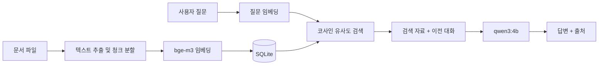

# Mobility Dev AI

문서를 등록하면 그 내용을 근거로 답변하는 **로컬 전용 RAG 챗봇**입니다.
Ollama와 SQLite만 사용하므로 문서와 대화 내용이 PC 밖으로 나가지 않고, 외부 AI API 키도 필요 없습니다.

## 주요 기능

- **문서 기반 답변:** PDF, PPTX, DOCX, TXT, MD 파일을 등록해 질문할 수 있습니다.
- **출처 표시:** 답변과 함께 문서명과 페이지 또는 슬라이드 번호를 보여줍니다.
- **문서 버전 관리:** SHA-256으로 중복 등록을 막고, 같은 파일명은 새 버전으로 등록합니다. 이전 버전으로 되돌릴 수도 있습니다.
- **지식과 메모:** 문서 외에 짧은 메모나 기억할 내용을 저장해 함께 검색합니다.
- **대화 세션:** 대화를 세션별로 저장하고 전환할 수 있습니다.
- **안전한 DB 마이그레이션:** 변경 전에 자동으로 백업하고, 하나의 트랜잭션으로 실행해 실패 시 전체를 롤백합니다.
- **검색 품질 평가:** Hit@k와 MRR로 검색 정확도를 측정합니다.

## 동작 구조



## 기술 스택

| 구분 | 사용 기술 |
|---|---|
| 언어 | Python 3.12 |
| LLM 실행 | Ollama |
| 답변 모델 | `qwen3:4b` |
| 임베딩 모델 | `bge-m3` |
| 저장소 | SQLite |
| 문서 파싱 | pypdf, python-docx, python-pptx |

## 시작하기

[Ollama](https://ollama.com)를 설치한 뒤 모델을 내려받습니다.

```powershell
ollama pull qwen3:4b
ollama pull bge-m3
```

가상환경을 만들고 의존성을 설치합니다.

```powershell
python -m venv .venv
.venv\Scripts\python.exe -m pip install -r requirements.txt
```

Windows에서는 `start_ai.bat`을 실행하면 Ollama 상태를 확인한 뒤 앱을 시작합니다. 직접 실행할 수도 있습니다.

```powershell
.venv\Scripts\python.exe main.py
```

DB는 첫 실행 시 자동으로 생성됩니다.

## 사용법

명령어가 아닌 문장을 입력하면 등록된 자료를 검색해 답변합니다.

| 구분 | 명령어 | 설명 |
|---|---|---|
| 문서 | `/file 파일경로` | 문서 등록 |
| | `/docs`, `/docs all` | 활성 문서 또는 모든 버전 목록 |
| | `/doc ID` | 문서 상세 |
| | `/reindex ID` | 재임베딩 |
| | `/activate ID` | 해당 버전을 사용 버전으로 지정 |
| | `/deldoc ID`, `/deldoc ID all` | 해당 버전 또는 모든 버전 삭제 |
| 지식 | `/add 제목 \| 내용` | 지식 추가 |
| | `/memory 내용` | 장기 기억 추가 |
| | `/list` | 지식 목록 |
| | `/edit ID \| 새 제목 \| 새 내용` | 지식 수정 |
| | `/delete ID` | 지식 삭제 |
| 대화 | `/new`, `/sessions`, `/use 세션ID` | 새 대화, 목록, 전환 |
| 기타 | `/stats`, `/help`, `/exit` | 통계, 도움말, 종료 |

## 프로젝트 구조

```text
├── main.py               # 터미널 채팅과 명령어 처리
├── rag.py                # 임베딩, 검색, 답변 생성
├── document_service.py   # 문서 등록, 버전 관리, 재임베딩, 삭제
├── document_loader.py    # 업로드 검증, 텍스트 추출, 청크 분할
├── knowledge_db.py       # SQLite 스키마, 마이그레이션, 저장소 계층
├── backup_db.py          # SQLite 온라인 백업
├── config.py             # 공통 설정
├── start_ai.bat          # Windows 실행 스크립트
├── eval/run_eval.py      # 검색 정확도 평가
└── tests/test_phase1.py  # 단위 및 통합 테스트
```

## 설정

`config.py`의 값 일부는 환경 변수로 바꿀 수 있습니다.

| 환경 변수 | 기본값 | 설명 |
|---|---|---|
| `MOBILITY_AI_DB` | `ai_data.db` | DB 파일 경로 |
| `MOBILITY_AI_DOC_STORE` | `storage/documents` | 원본 문서 사본 저장 위치 |
| `OLLAMA_BASE_URL` | `http://127.0.0.1:11434` | Ollama 주소 |
| `MOBILITY_AI_CHAT_MODEL` | `qwen3:4b` | 답변 모델 |
| `MOBILITY_AI_EMBED_MODEL` | `bge-m3` | 임베딩 모델 |

## 테스트

```powershell
.venv\Scripts\python.exe -m unittest discover -s tests -v
```

테스트는 임시 DB만 사용합니다. 실제 DB 백업이나 샘플 PPTX가 필요한 테스트는 해당 파일이 없으면 자동으로 건너뜁니다.

## 검색 품질 평가

문서 하나에 대한 질문 19개로 측정한 결과입니다. 평가 데이터는 비공개 문서를 기반으로 하여 저장소에 포함하지 않았습니다.

| 구성 | Hit@1 | Hit@3 | Hit@5 | MRR |
|---|---|---|---|---|
| 현재 기준선 | 0.579 | 0.842 | 0.895 | 0.712 |
| 슬라이드 단위 재청크 (실험) | 0.632 | 0.947 | 0.947 | 0.781 |

직접 평가하려면 아래 형식으로 `eval/questions.json`을 만들어 실행합니다.

```json
{
  "document": "sample.pptx",
  "questions": [
    {"id": "Q01", "question": "질문 내용", "gold_slides": [3], "keywords": ["핵심어"]}
  ]
}
```

```powershell
.venv\Scripts\python.exe eval\run_eval.py --label baseline
```

평가는 DB 사본에서 실행되어 원본 DB를 수정하지 않습니다.

## 로드맵

- [ ] 키워드와 벡터를 결합한 하이브리드 검색
- [ ] 이전 대화를 반영한 후속 질문 처리
- [ ] 리랭커를 활용한 문서 외 질문 거절
- [ ] Streamlit 웹 UI
